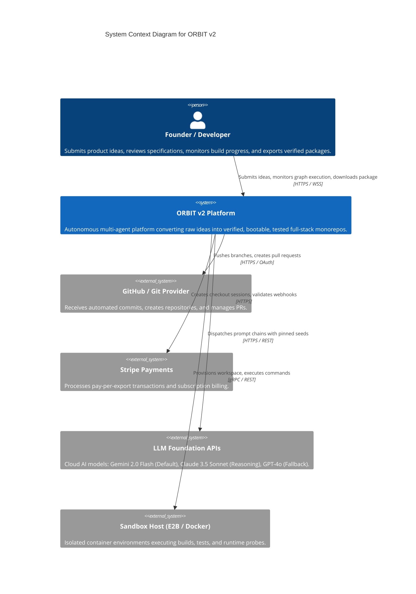
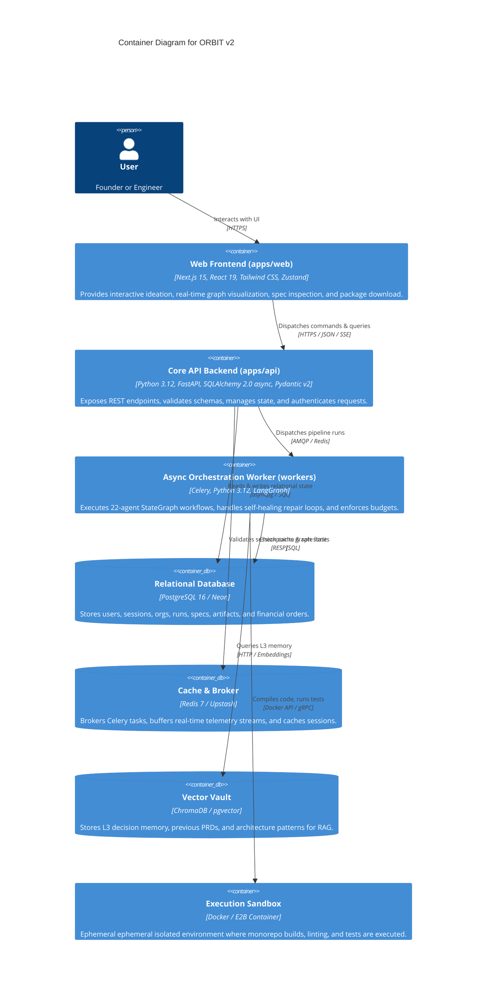
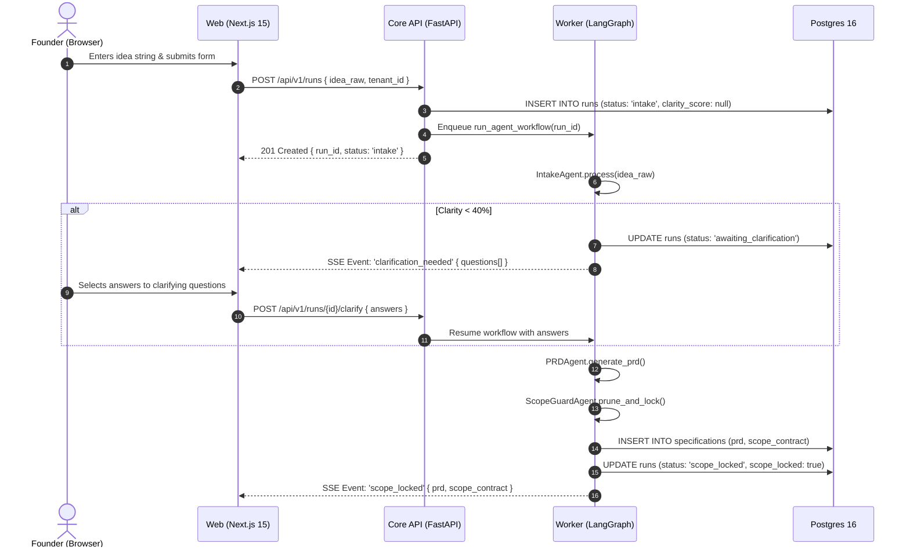
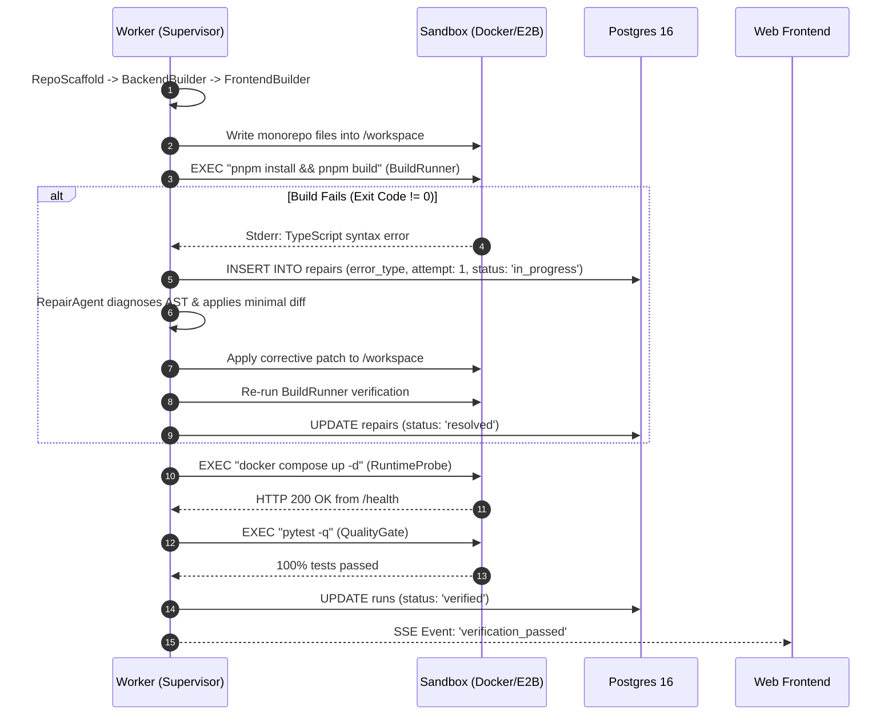
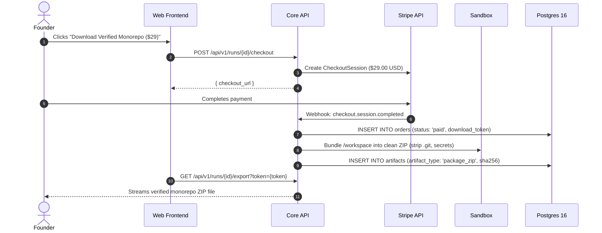
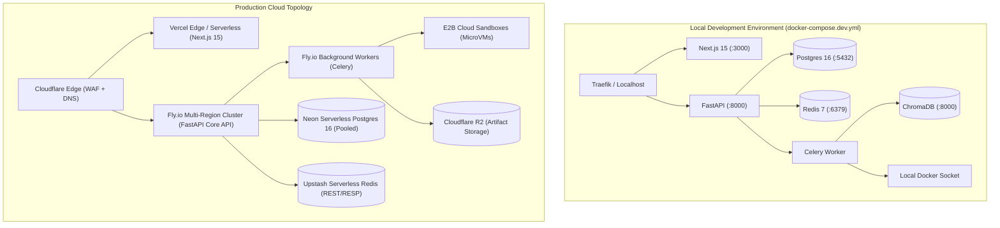

# ORBIT v2 — System Architecture & Technical Specification

**Version**: 2.0.0  
**Status**: APPROVED  
**Author**: SystemArchitectAgent (Division B1)  
**Target Delivery**: Enterprise Monorepo & Sandboxed Factory Platform  

---

## 1. C4 Architecture Models

### 1.1 Level 1: System Context Diagram
The System Context diagram illustrates how founders, engineers, and external SaaS platforms interact with the ORBIT v2 platform boundary.

---

### 1.2 Level 2: Container Diagram
The Container diagram illustrates the high-level services, databases, queues, and message brokers composing ORBIT v2.

---

## 2. Service Boundaries

| Service | Technology Stack | Primary Boundary Responsibilities | Communication Protocol |
|---|---|---|---|
| **Web Frontend** (`apps/web`) | Next.js 15 App Router, React 19, Tailwind CSS, Zustand, React Query | User presentation, auth state, interactive clarifying dialogs, real-time telemetry rendering via Server-Sent Events (SSE). | Consumes REST & SSE from `Core API`. |
| **Core API** (`apps/api`) | FastAPI, Pydantic v2, Python 3.12, Uvicorn | Request validation, JWT authentication, permission checks, run lifecycle management, Stripe webhook handling, artifact file streaming. | Exposes OpenAPI 3.1 HTTP endpoints; interfaces with DB, Cache, Celery. |
| **Worker Engine** (`workers`) | Celery 5.4, LangGraph 1.2, LangChain Core | Autonomous multi-agent pipeline execution (Divisions A→D), model invocations, budget tracking, repair loops. | Consumes Celery queue from Redis; writes to DB, Sandbox, ChromaDB. |
| **Relational Database** (`db`) | PostgreSQL 16 (Neon in prod, Postgres in dev) | ACID durable storage: `users`, `sessions`, `orgs`, `memberships`, `runs`, `specifications`, `artifacts`, `repairs`, `orders`. | `asyncpg` connection pooling on port 5432. |
| **Cache & Message Broker** (`cache`) | Redis 7 (Upstash in prod) | Celery task queue broker, distributed locks, rate-limiting counters, and ephemeral pub/sub event bus. | RESP protocol on port 6379. |
| **Vector Memory** (`vector`) | ChromaDB (dev) / pgvector (prod) | L3 long-term organizational memory, architectural patterns, competitor benchmarks, and semantic PRD search. | Vector embeddings generated via `text-embedding-3-small`. |
| **Ephemeral Sandbox** (`sandbox`) | Local Docker Daemon (dev) / E2B (prod) | Isolated micro-container executing `pnpm install`, `pnpm build`, `pytest`, container runtime probes, and diff generation. | Docker SDK socket / E2B Python SDK. |

---

## 3. End-to-End Data Flow Per User Action

### Action 1: User Submits Raw Idea & Resolves Clarifications (Division A)

### Action 2: Monorepo Scaffolding & Verification Repair Loop (Divisions B & C)

### Action 3: Purchase & Clean Monorepo ZIP Export (Division D)

---

## 4. Authentication & Authorization Strategy

### Chosen Approach: Short-Lived JWT + Rotating Refresh Tokens in PostgreSQL

**Architecture Specification**:
1. **Access Token**:
   - Format: Signed RFC 7519 JSON Web Token (JWT).
   - Algorithm: `HS256` (dev) / `RS256` (prod).
   - Lifetime: 15 minutes.
   - Claims: `{ "sub": user_id, "org_id": org_id, "role": role, "exp": ..., "iat": ... }`.
   - Transmission: `Authorization: Bearer <access_token>` HTTP header.
2. **Refresh Token**:
   - Format: Cryptographically secure 256-bit random entropy string (`secrets.token_urlsafe(32)`).
   - Lifetime: 30 days.
   - Storage: SHA-256 hashed in the `sessions` PostgreSQL table; transmitted to client in a strict `HttpOnly; Secure; SameSite=Strict; Path=/api/v1/auth` cookie.
   - Rotation: Every call to `POST /api/v1/auth/refresh` revokes the previous refresh token and issues a new pair. Reuse of an already-invalidated refresh token triggers immediate session termination across all devices (theft detection).

### Justification & Trade-Off Matrix

| Strategy | Security Posture | Horizontal Scalability | Latency / DB Load | Verdict |
|---|---|---|---|---|
| **Stateless Pure JWT** | High risk: Revocation before expiry is impossible without a centralized blacklist. | High (zero DB lookups per API request). | Fast (crypto validation only). | **Rejected**: Revocation is mandatory for multi-tenant SaaS compliance. |
| **Stateful Server Sessions (Redis)** | High: Instant revocation via key deletion. | High, but creates a hard single point of failure on the Redis cluster. | High network overhead: every API call incurs Redis network hop. | **Rejected**: Increases infrastructure complexity and coupling. |
| **JWT Access (15m) + Rotating Refresh DB (Chosen)** | **Maximum**: Fast API authorization with instantaneous revocation window (<15m) and automated theft detection on refresh. | **Maximum**: API nodes validate access tokens independently. DB hit occurs only once every 15 minutes per active client. | Minimal load on primary Postgres database while maintaining full auditability. | **SELECTED** |

---

## 5. Hosting Topology & Deployment Environments

### Environment Configurations

| Dimension | Local Development (`dev`) | Production (`prod`) |
|---|---|---|
| **Frontend** | Node.js 22 dev server (`pnpm dev`) on `localhost:3000` | Vercel Edge / Serverless global CDN with automatic PR previews |
| **Backend API** | Uvicorn reload (`python -m uvicorn app.main:app`) | Fly.io auto-scaling Docker container cluster across global edge regions |
| **Background Workers** | Celery worker with concurrency 4 (`celery -A app.workers.celery_app worker`) | Fly.io dedicated background worker VMs with Celery auto-scaling |
| **Database** | Docker container PostgreSQL 16 on `localhost:5432` | Neon Serverless PostgreSQL with auto-scaling compute and connection pooling |
| **Cache & Queue** | Docker container Redis 7 on `localhost:6379` | Upstash Serverless Redis with zero-idle cost and persistent AOF |
| **Sandbox Execution** | Local Docker daemon (`/var/run/docker.sock`) | E2B isolated Linux microVMs with 200ms cold-start and hardened firewalls |
| **File Storage** | Local directory `.orbit/artifacts/` | Cloudflare R2 / AWS S3 with signed URLs and SSE-KMS encryption |

---

## 6. Architecture Decision Records (ADRs)

### ADR-001: LangGraph StateGraph Supervisor Pattern for Multi-Agent Orchestration
- **Status**: ACCEPTED
- **Context**: Autonomous multi-agent development requires coordination of 22 specialized agents across 4 divisions (specifications, coding, verification, packaging). Autonomous swarm models (AutoGPT, CrewAI) suffer from non-deterministic looping, prompt drifting, and unpredictable token consumption.
- **Alternatives Considered**:
  1. *Linear Sequential Pipeline (Bash/Airflow)*: Inflexible; cannot handle dynamic conditional loopbacks from test verification failures.
  2. *Free-form Agent Swarms (CrewAI / AutoGen)*: High token waste; prone to infinite conversational loops without formal state contracts.
- **Decision**: Adopt LangGraph `StateGraph` with a centralized supervisor. State is defined strictly via Pydantic v2 schemas (`OrbitState`) with typed reducers. All agent transitions emit telemetry events and enforce strict per-agent step/token quotas.
- **Consequences**:
  - *Positive*: 100% deterministic routing; checkpointable with SQLite (dev) and Postgres (prod); visible DAG structure with explicit repair loops.
  - *Negative*: Every agent capability must be defined within typed tool contracts; no ad-hoc shell execution.

### ADR-002: PostgreSQL 16 + SQLAlchemy 2.0 Async as the Unified Data Foundation
- **Status**: ACCEPTED
- **Context**: The platform needs relational consistency for organizations, billing, user accounts, and immutable run artifacts, alongside structured JSON specifications (`PRD.md`, `scope_contract.json`).
- **Alternatives Considered**:
  1. *MongoDB / NoSQL*: Weak relational support for memberships, permissions, and Stripe transactions.
  2. *DynamoDB Single-Table Design*: Excellent serverless scaling, but cumbersome schema migrations and difficult ad-hoc reporting for audit ledgers.
- **Decision**: Standardize on PostgreSQL 16 utilizing 3NF normalized tables with indexed Foreign Keys, `TIMESTAMPTZ` audit timestamps, and `JSONB` for schema specifications. Access is orchestrated via `SQLAlchemy 2.0 async` and `asyncpg`.
- **Consequences**:
  - *Positive*: Strict relational integrity, transaction guarantees for financial orders, mature migration tooling via Alembic.
  - *Negative*: Requires connection pooling (PgBouncer / Neon) when scaling thousands of concurrent serverless connections.

### ADR-003: Ephemeral Docker & E2B Sandboxes with `SandboxProvider` ABC
- **Status**: ACCEPTED
- **Context**: Agents must compile monorepos, install npm/pip dependencies, execute unit tests, and launch live web services without risking host machine pollution or security vulnerabilities.
- **Alternatives Considered**:
  1. *Host Process Execution (`subprocess.run`)*: Catastrophic security hazard; vulnerable to malicious package scripts and dependency collision.
  2. *Heavy Full-VM Provisioning (AWS EC2)*: Slow provisioning time (2-5 minutes); cost prohibitive for rapid feedback loops.
- **Decision**: Define a single `SandboxProvider` Abstract Base Class. In local development, the provider interfaces with the local Docker daemon. In production, it provisions ephemeral E2B microVMs (<200ms startup) with dedicated network isolation.
- **Consequences**:
  - *Positive*: Absolute filesystem isolation; reproducible builds from a clean `/workspace` root; zero risk of credential leaks into host environment.
  - *Negative*: Requires Docker installed locally for development engineers.

### ADR-004: Standardized Error Envelope and Rate Limiting via OpenAPI 3.1
- **Status**: ACCEPTED
- **Context**: Both human developers using the Next.js UI and automated agents interacting via generated API clients require predictable, typed error structures and rate limit boundaries.
- **Alternatives Considered**:
  1. *Default FastAPI HTTPExceptions*: Emits plain `{ "detail": "..." }`, which lacks machine-readable error codes and validation contexts.
- **Decision**: Enforce a strict error envelope schema across all endpoints: `{ "code": str, "message": str, "details": dict }`. Embed rate limits directly into OpenAPI specifications via `x-rate-limit` extensions and enforce them via Redis sliding windows.
- **Consequences**:
  - *Positive*: Client SDKs can reliably catch specific error codes (`INSUFFICIENT_BUDGET`, `SCOPE_LOCKED`, `GATE_FAILED`); uniform frontend toast/alert handling.
  - *Negative*: Minor boilerplate wrapping exception handlers in FastAPI middleware.
