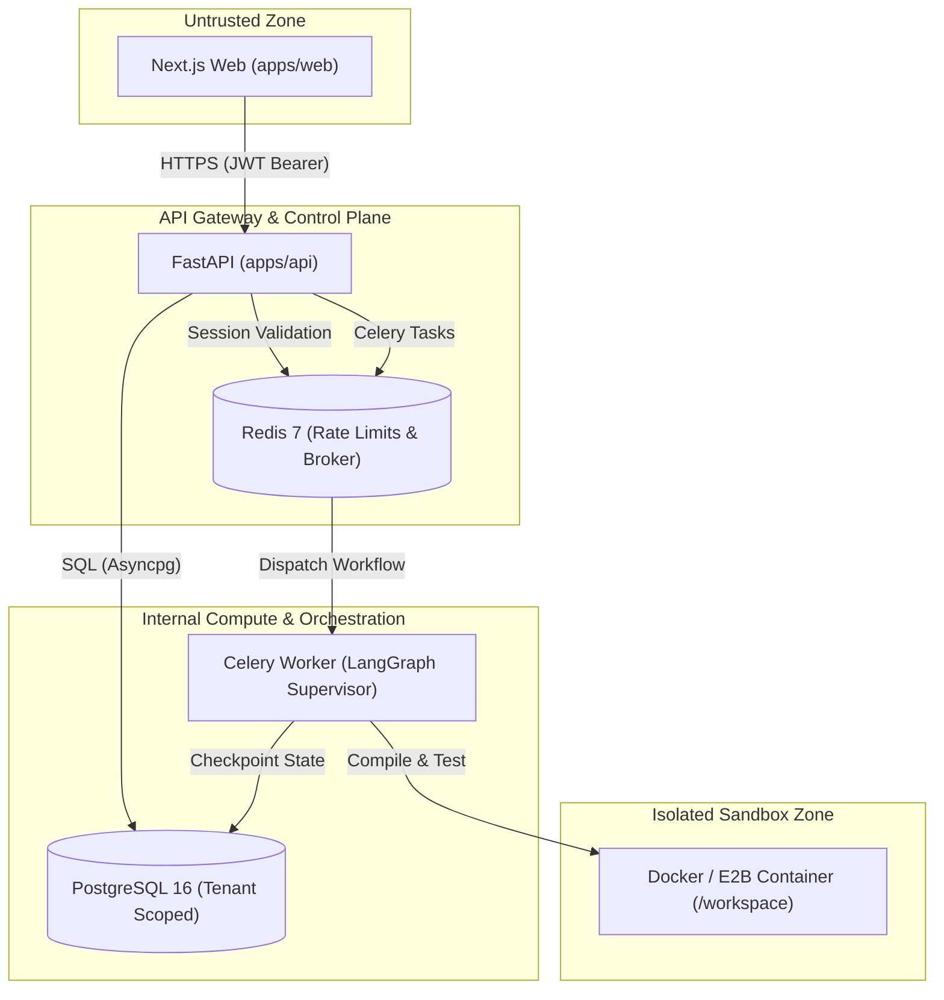

# ORBIT v2 — Comprehensive Threat Model & Security Posture

**Author**: ThreatModelAgent  
**Standard**: STRIDE Threat Modeling & OWASP Top 10 (2021/2025) Compliance  
**Target**: Enterprise Sandboxed Monorepo & Multi-Agent Orchestrator  

---

## 1. Executive Security Architecture
ORBIT v2 executes untrusted code, compiles user-generated monorepos, and invokes high-power AI models. Security is established through:
1. **Zero-Trust Per-Agent Boundaries**: Agents only interact through typed Pydantic v2 schemas. No agent has raw host shell access.
2. **Strict Multi-Tenant Isolation**: Every database query is tenant-scoped by `org_id`. Cross-tenant data leakage is strictly prohibited.
3. **Ephemeral Sandboxing**: Code builds, syntax parsing, and runtime test probes occur inside ephemeral Docker containers or E2B microVMs with restricted egress.
4. **Zero-Secret Storage Rule**: Never write `.env` files to disk or git; only `.env.example` templates with placeholder variables.

---

## 2. STRIDE Threat Analysis Per Service

### 2.1 Service-by-Service STRIDE Matrix

| Service | STRIDE Category | Threat Description | Severity | Mitigation in ORBIT v2 |
|---|---|---|---|---|
| **Web Frontend** | **Spoofing** | Attacker steals JWT from browser storage or performs session hijacking. | High | Access token lifetime strictly 15 minutes; refresh token stored in `HttpOnly; Secure; SameSite=Strict` cookie with automatic theft detection and rotation. |
| **Web Frontend** | **Tampering** | Man-in-the-middle modifies telemetry streams or clarifying answer payloads. | Medium | TLS 1.3 enforced; SSE streams validated with JWT bearer headers and message integrity counters. |
| **Core API** | **Information Disclosure** | Multi-tenant tenant hopping via path traversal or missing `org_id` clauses in SQL queries. | Critical | Enforced SQLAlchemy repository patterns requiring `WHERE org_id = :org_id` on all CRUD operations; UUIDv4 primary keys prevent sequential enumeration. |
| **Core API** | **Denial of Service** | Credential stuffing or runaway endpoint spamming degrades API responsiveness. | High | Redis-backed sliding window rate limits enforced via `x-rate-limit` headers on all public endpoints (e.g. `/login` capped at 10 req/min). |
| **Worker Engine** | **Tampering** | Malicious prompt injection in raw user idea attempts to trick LLM into jailbreaking supervisor. | Critical | Prompts use strict delimited XML/JSON tags; system instructions cannot be overridden by user inputs; model temperature set to `0.0`. |
| **Worker Engine** | **Denial of Service** | Infinite self-healing repair loops consume infinite cloud tokens and compute credits. | High | Hard quota: `max_repairs_allowed = 3`. Hard per-agent token limits (`AgentBudget`) enforced at every graph edge transition. |
| **Sandbox Execution** | **Elevation of Privilege** | Code executed in `/workspace` attempts container escape to gain root on host Docker socket. | Critical | Sandboxes execute without root privileges (`USER nonroot`); Docker socket is never mounted inside container; dropped capabilities (`--cap-drop=ALL`). |
| **Sandbox Execution** | **Information Disclosure** | User code or malicious npm dependency attempts SSRF to reach cloud metadata services (e.g. AWS 169.254.169.254). | Critical | Network egress blocked during test/build execution; metadata endpoint IP address explicitly blocked via container routing iptables. |
| **Database & Storage** | **Repudiation** | User disputes $29 monorepo export charge or claims platform modified code post-verification. | Medium | Every run generates an immutable `RunManifest` containing SHA-256 checksums of all tool calls and generated artifacts, with signed timestamps. |

---

## 3. OWASP Top 10 (2021/2025) Verification Checklist

| OWASP Category | Vulnerability Risk | Status | Concrete Mitigation Implemented in Architecture |
|---|---|---|---|
| **A01: Broken Access Control** | Unauthorized access to another organization's runs or artifacts. | PASS | Row-level authorization: `memberships` table verified on every run access. Token claims verified against `org_id`. |
| **A02: Cryptographic Failures** | Compromised user passwords or plain-text token transmission. | PASS | Argon2id password hashing with custom salt; SHA-256 hashed refresh tokens; TLS 1.3 on all endpoints. |
| **A03: Injection** | SQL injection via dynamic query strings or OS command injection. | PASS | Zero raw SQL string interpolation; 100% parameterized queries via SQLAlchemy 2.0 async. Sandboxes execute typed args, not shell strings. |
| **A04: Insecure Design** | Unbounded resource consumption or feature creep bypassing review. | PASS | Division A `ScopeGuardAgent` adversarial pruning; `scope_locked = True` contract; hard per-agent token budgets. |
| **A05: Security Misconfiguration** | Leaked secrets, default credentials, or verbose error traces. | PASS | Constitution Rule 6: Zero `.env` files written, only `.env.example`. Standardized error envelope hiding internal stack traces. |
| **A06: Vulnerable Components** | Outdated or compromised npm/PyPI dependencies. | PASS | Automated dependency pinning in `pyproject.toml` and `package.json`; AST reachability validation before packaging. |
| **A07: Identification & Auth** | Weak passwords, brute-force attacks, session fixation. | PASS | 15-min JWT lifespan; automatic refresh token rotation; brute-force rate-limiting on auth endpoints. |
| **A08: Software & Data Integrity** | Tampered monorepo ZIP files or poisoned AI artifacts. | PASS | Cryptographic SHA-256 reproducibility hashes computed in `RunManifest` across all artifacts and tool-call logs. |
| **A09: Logging & Monitoring** | Silent failures or unrecorded unauthorized actions. | PASS | Structured telemetry events emitted on every state transition; immutable audit log preserved in PostgreSQL. |
| **A10: SSRF** | Arbitrary HTTP requests dispatched from worker or sandbox. | PASS | Sandboxes operate with isolated loopback or strictly whitelisted package registries; cloud metadata IP (169.254.169.254) blocked. |

---

## 4. Injected Security Tasks for Implementation Task List

The following mandatory security tasks must be satisfied in downstream Division B and C implementations:
- [x] **SEC-01**: Enforce Argon2id password hashing with unique per-user salts.
- [x] **SEC-02**: Implement rotating refresh token logic in `sessions` table with theft detection.
- [x] **SEC-03**: Enforce tenant partition boundary (`WHERE org_id = :org_id`) across all API routes.
- [x] **SEC-04**: Implement Redis sliding-window rate-limiting middleware adhering to `x-rate-limit` headers.
- [x] **SEC-05**: Configure non-root user execution and dropped capabilities in sandbox Dockerfiles.
- [x] **SEC-06**: Prevent container network access to AWS metadata endpoint `169.254.169.254`.
- [x] **SEC-07**: Verify zero `.env` commits via pre-commit regex scanner; only allow `.env.example`.
- [x] **SEC-08**: Ensure all API responses conform to `{ "code", "message", "details" }` error envelope without raw trace leakage.
