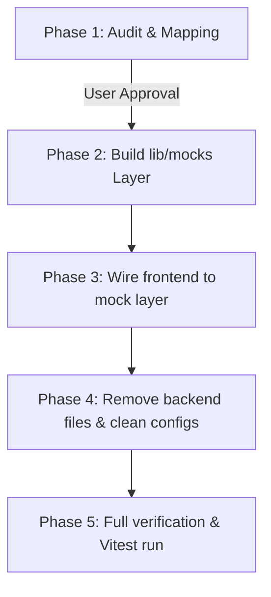

# ORBIT AI — Backend Removal & Frontend Mock Migration Plan
**Phase 1: Audit and Mapping Document**  
**Version:** 1.0.0  
**Status:** COMPLETE (Awaiting User Approval — Zero Files Modified or Deleted)  
**Date:** October 23, 2026  

---

## 1. Executive Summary & Objective

The objective of this initiative is to decouple and remove the legacy Python/FastAPI/Celery/LangGraph/ChromaDB backend while preserving 100% of the frontend's visual fidelity, interactive narrative, and user workflows. 

Following the strict protocol defined in `.antigravity/rules.md`:
- **Phase 1 (This Document)**: Comprehensive inventory, network call tracing, delete list, modify list, and mock architecture.
- **Rules Adherence**: **NO code or files have been deleted or modified.** Phase 2 execution will begin only upon explicit user sign-off.

---

## 2. Frontend Network & Architecture Trace

The frontend is a **Next.js 15 App Router** application located in `apps/frontend/`. Analysis of all HTTP requests, Server-Sent Events (SSE), and state stores reveals the following data flow:

### 2.1 API Endpoint Matrix (`apps/frontend/lib/api/client.ts`)

All network calls are channeled through the centralized client at `apps/frontend/lib/api/client.ts`, which defaults to `http://localhost:8000/v1` via `process.env.NEXT_PUBLIC_API_URL`.

| Domain | Method & Route | Frontend Consumer Function | Used In Files |
| :--- | :--- | :--- | :--- |
| **Auth** | `POST /v1/auth/login` | `authApi.login` | `components/auth/AuthPortal.tsx`, `components/auth/auth-form.tsx` |
| | `POST /v1/auth/register` | `authApi.register` | `components/auth/AuthPortal.tsx`, `components/auth/auth-form.tsx` |
| | `POST /v1/auth/refresh` | `authApi.refresh` | Automatic token refresher in `client.ts` |
| | `GET /v1/auth/me` | `authApi.me` | `components/layout/app-shell.tsx` |
| | `POST /v1/auth/logout` | `authApi.logout` | `components/layout/app-shell.tsx` |
| | `POST /v1/auth/otp/send` | `authApi.sendOtp` | `components/auth/AuthPortal.tsx` |
| | `POST /v1/auth/otp/verify` | `authApi.verifyOtp` | `components/auth/AuthPortal.tsx` |
| | `POST /v1/auth/forgot-password` | `authApi.forgotPassword` | `components/auth/auth-form.tsx` |
| | `POST /v1/auth/reset-password` | `authApi.resetPassword` | `components/auth/auth-form.tsx` |
| | `POST /v1/auth/oauth/google` | `authApi.googleOAuth` | `components/auth/AuthPortal.tsx` |
| **Projects** | `GET /v1/projects` | `projectsApi.list` | `app/(app)/dashboard/page.tsx`, `components/layout/app-shell.tsx`, `components/ui/command-palette.tsx` |
| | `GET /v1/projects/:id` | `projectsApi.get` | `app/(app)/projects/[projectId]/page.tsx` |
| | `POST /v1/projects` | `projectsApi.create` | `app/(app)/projects/new/page.tsx` |
| | `PATCH /v1/projects/:id` | `projectsApi.update` | Project settings & status updates |
| | `DELETE /v1/projects/:id` | `projectsApi.remove` | Project deletion |
| | `POST /v1/projects/:id/pipeline/start` | `projectsApi.startPipeline` | `app/(app)/projects/new/page.tsx` |
| | `GET /v1/projects/:id/pipeline/latest` | `projectsApi.latestPipelineStatus` | `app/(app)/projects/[projectId]/page.tsx` |
| | `GET /v1/projects/:id/pipeline/:runId` | `projectsApi.pipelineStatus` | Pipeline polling fallback |
| | `GET /v1/projects/:id/pipeline/:runId/result` | `projectsApi.pipelineResult` | Full pipeline deliverables retrieval |
| | `GET /v1/projects/:id/reports` | `projectsApi.reports` | Operational report cards |
| | `GET /v1/projects/:id/artifacts/:type` | `projectsApi.artifact.*` | `research`, `prd`, `roadmap`, `financials`, `pitch`, `vc` in `[projectId]/page.tsx` |
| | `GET /v1/projects/:id/execution` | `projectsApi.execution` | `components/workspace/execution-center.tsx`, `[projectId]/page.tsx` |
| | `POST /v1/projects/:id/execution/regenerate` | `projectsApi.regenerateExecution`| `components/workspace/execution-center.tsx` |
| | `PATCH /v1/projects/:id/execution/tasks/:taskId` | `projectsApi.updateExecutionTask`| `components/workspace/execution-center.tsx` |
| **Co-Founder** | `GET /v1/cofounder/history` | `cofounderApi.history` | `components/mission-control/GeminiMissionPanel.tsx`, `PersistentCofounderHUD.tsx`, `RecentDecisionsLedger.tsx` |
| | `POST /v1/cofounder/chat` | `cofounderApi.chat` | `components/mission-control/GeminiMissionPanel.tsx`, `PersistentCofounderHUD.tsx`, `ai-assistant.tsx` |
| | `GET /v1/cofounder/memory` | `cofounderApi.getMemory` | `components/workspace/startup-memory-vault.tsx` |
| | `GET /v1/cofounder/guidance` | `cofounderApi.getGuidance` | `components/cofounder/WorkspaceCofounderBanner.tsx` |
| | `POST /v1/cofounder/decisions` | `cofounderApi.logDecision` | `components/cofounder/PersistentCofounderHUD.tsx` |
| | `POST /v1/cofounder/challenge` | `cofounderApi.challengeAssumption` | `components/cofounder/CenterIntelligenceSection.tsx` |
| **Debate** | `GET /v1/projects/:id/debate` | `apiFetch` (direct) | `components/workspace/agent-debate-system.tsx` |
| | `POST /v1/projects/:id/debate` | `apiFetch` (direct) | `components/workspace/agent-debate-system.tsx` |
| **Memory** | `GET /v1/projects/:id/memory` | `memoryApi.getState` | `components/workspace/startup-memory-vault.tsx` |
| | `POST /v1/projects/:id/memory/search` | `memoryApi.search` | `components/workspace/startup-memory-vault.tsx` |
| | `POST /v1/projects/:id/memory/index` | `memoryApi.index` | `components/workspace/startup-memory-vault.tsx` |
| | `POST /v1/projects/:id/memory/record` | `memoryApi.record` | `components/workspace/startup-memory-vault.tsx` |
| | `GET /v1/projects/:id/memory/stats` | `memoryApi.getStats` | `components/workspace/startup-memory-vault.tsx` |
| | `DELETE /v1/projects/:id/memory/:memId`| `memoryApi.delete` | `components/workspace/startup-memory-vault.tsx` |
| **Admin** | `GET /v1/admin/overview` | `adminApi.overview` | `app/(app)/admin/page.tsx` |
| | `GET /v1/admin/users` | `adminApi.users` | `app/(app)/admin/page.tsx` |
| **Health** | `GET /health` | `getApiHealth` | `app/(app)/settings/account/page.tsx`, diagnostics |

### 2.2 SSE Real-Time Stream Trace
- **Location**: `apps/frontend/lib/stores/startup-store.ts` (lines 186–208)
- **Call**: `new EventSource(`${apiUrl}/projects/${projectId}/stream`)`
- **Trigger**: Invoked in `apps/frontend/app/(app)/projects/[projectId]/page.tsx` inside a `useEffect` when entering a project workspace.
- **Events**: Receives `artifact_updated`, `agent_step`, and `pipeline_progress` events to stream agent status updates across the UI.

### 2.3 Authentication Lifecycle Trace
- **State Store**: `apps/frontend/lib/stores/auth-store.ts` (Zustand + `localStorage` persistence).
- **Session Keys**: `accessToken`, `expiresAt`, `user`, `hasHydrated`.
- **Navigation Guard**: In `components/layout/app-shell.tsx`, unauthenticated visitors are redirected to `/login`, while authenticated users have their JWT injected into the `Authorization: Bearer <token>` header on every request.

---

## 3. Exact Delete List (Old Backend)

The following files, folders, and configs belong strictly to the old backend stack (FastAPI, LangGraph, Celery, ChromaDB, SQLAlchemy, PostgreSQL, and Poetry) and are scheduled for removal in Phase 4.

### 3.1 Backend Application Core (`apps/backend/`)
```text
apps/backend/
├── .dockerignore
├── .env.example
├── Dockerfile
├── alembic.ini
├── pyproject.toml
├── poetry.lock
├── check_db.py
├── generate_orbit_guide_pdf.py
├── scratch_test_api.py
├── alembic/
│   ├── env.py
│   ├── script.py.mako
│   └── versions/
│       ├── 134d42a430c6_initial_schema.py
│       ├── 59df99766343_add_artifact_decision_and_task_models.py
│       ├── 88d9bf975e0b_add_stage_executions_and_decision_fields.py
│       └── b97c4a38f110_add_execution_and_memory.py
├── app/
│   ├── __init__.py
│   ├── main.py
│   ├── agents/
│   │   ├── __init__.py
│   │   ├── agent_tools.py
│   │   ├── demo.py
│   │   ├── dev_manager_agent.py
│   │   ├── developer.py
│   │   ├── discovery.py
│   │   ├── discovery_agents.py
│   │   ├── prd_design_agents.py
│   │   ├── product_agent.py
│   │   ├── providers.py
│   │   ├── risk_analysis.py
│   │   ├── specialist_agents.py
│   │   ├── tech_agent.py
│   │   └── nodes/__init__.py
│   ├── api/
│   │   ├── runs.py
│   │   └── v1/
│   │       ├── __init__.py
│   │       ├── admin.py
│   │       ├── auth.py
│   │       ├── execution.py
│   │       ├── impact.py
│   │       ├── memory.py
│   │       ├── pipeline.py
│   │       ├── projects.py
│   │       ├── router.py
│   │       └── stream.py
│   ├── core/
│   │   ├── __init__.py
│   │   ├── config.py
│   │   ├── errors.py
│   │   ├── logging.py
│   │   └── security.py
│   ├── db/
│   │   ├── __init__.py
│   │   ├── base.py
│   │   ├── init_admin.py
│   │   ├── init_db.py
│   │   ├── seed.py
│   │   └── session.py
│   ├── graph/
│   │   ├── __init__.py
│   │   ├── budgets.py
│   │   ├── checkpointer.py
│   │   ├── manifest.py
│   │   ├── pipeline.py
│   │   ├── progress.py
│   │   ├── state.py
│   │   └── supervisor.py
│   ├── middleware/
│   │   ├── __init__.py
│   │   ├── logging_middleware.py
│   │   └── rbac_middleware.py
│   ├── models/
│   │   ├── __init__.py
│   │   ├── agent.py
│   │   ├── agent_run.py
│   │   ├── artifact.py
│   │   ├── audit_log.py
│   │   ├── decision.py
│   │   ├── document.py
│   │   ├── execution.py
│   │   ├── financial_model.py
│   │   ├── mixins.py
│   │   ├── notification.py
│   │   ├── pitch_deck.py
│   │   ├── project.py
│   │   ├── report.py
│   │   ├── session.py
│   │   ├── stage_execution.py
│   │   ├── subscription.py
│   │   ├── task.py
│   │   └── user.py
│   ├── orchestration/
│   │   ├── __init__.py
│   │   ├── agent_graph.py
│   │   ├── celery_tasks.py
│   │   ├── event_bus.py
│   │   └── langgraph_debater.py
│   ├── repositories/
│   │   ├── __init__.py
│   │   ├── agent_repository.py
│   │   ├── agent_run_repository.py
│   │   ├── audit_log_repository.py
│   │   ├── base_repository.py
│   │   ├── document_repository.py
│   │   ├── financial_model_repository.py
│   │   ├── notification_repository.py
│   │   ├── pitch_deck_repository.py
│   │   ├── project_repository.py
│   │   ├── report_repository.py
│   │   ├── subscription_repository.py
│   │   └── user_repository.py
│   ├── sandbox/
│   │   ├── __init__.py
│   │   └── provider.py
│   ├── schemas/
│   │   ├── __init__.py
│   │   ├── auth.py
│   │   ├── cofounder_intelligence.py
│   │   ├── debate.py
│   │   ├── execution.py
│   │   ├── memory.py
│   │   ├── pipeline.py
│   │   ├── pipeline_traceability.py
│   │   ├── project.py
│   │   └── agent_io/
│   │       ├── __init__.py
│   │       └── pipeline.py
│   ├── services/
│   │   ├── __init__.py
│   │   ├── artifact_service.py
│   │   ├── artifact_storage.py
│   │   ├── auth_service.py
│   │   ├── cofounder_service.py
│   │   ├── execution_service.py
│   │   ├── memory_service.py
│   │   ├── pipeline_service.py
│   │   ├── project_service.py
│   │   └── vector_store.py
│   ├── tools/
│   │   ├── __init__.py
│   │   ├── artifact.py
│   │   ├── context.py
│   │   ├── fs.py
│   │   ├── shell.py
│   │   └── test.py
│   └── workers/
│       ├── __init__.py
│       ├── celery_app.py
│       └── tasks/
│           ├── __init__.py
│           ├── health.py
│           └── pipeline.py
├── data/
│   └── chroma_db/ (all sqlite & binary vector files)
└── tests/ (all python test suites: unit, integration, e2e, agent_evals)
```

### 3.2 Database Packages & Backend Shared Specs
```text
packages/db/
├── chroma_lessons_v1.json
├── migrations/001_init.sql
├── models.py
├── schema.sql
└── seeds.sql

packages/shared/
├── openapi.yaml
└── client/
    ├── api.ts
    ├── index.ts
    └── types.ts
```

### 3.3 Backend Scripts
```text
scripts/e2e_test_runner.py
scripts/setup.sh
```

### 3.4 Backend Workflows & CI
```text
.github/workflows/e2e-pipeline.yml
```
*(In `.github/workflows/ci.yml`, the `backend` and `docker-build` jobs will be removed, retaining the `frontend` job).*

### 3.5 Infrastructure & Root Configuration
- In `docker-compose.yml`: Remove `postgres`, `redis`, `chromadb`, `backend`, `celery-worker`, and `celery-beat` service definitions.
- In `docker-compose.dev.yml`: Remove backend mount overrides.
- In `Makefile`: Remove `migrate`, `migration`, `seed`, `test-backend`, `lint-backend`, and `backend-shell`.
- Parent workspace cleanups (junctions/stale runs): `backend/`, `app/`, `tests/e2e/test_full_pipeline.py`.

---

## 4. Exact Modify List (Frontend Files)

The frontend remains structurally intact. Modifications are focused strictly on swapping live HTTP requests for the mock engine.

### Tier 1: Core Adapters (Zero-Regression Architecture)
By modifying `apps/frontend/lib/api/client.ts` to return mock data from `apps/frontend/lib/mocks/`, the entire application continues functioning **without breaking a single component import or method signature**.

| File Path | Description of Necessary Modification |
| :--- | :--- |
| `apps/frontend/lib/api/client.ts` | **Primary Swap:** Replace `request()` and `apiFetch()` with mock handlers (`authMock`, `projectsMock`, `cofounderMock`, `memoryMock`, `adminMock`). Simulate async latency (150–300ms) to preserve React Query skeleton and Framer Motion transitions. |
| `apps/frontend/lib/stores/startup-store.ts` | **SSE Swap:** In `connectStream(projectId)`, replace `new EventSource(...)` with an in-browser mock event generator that emits simulated agent step and artifact update events. |
| `apps/frontend/lib/stores/auth-store.ts` | Provide an automatic default mock founder session so the application is immediately explorable upon launch. |
| `apps/frontend/lib/api/client.test.ts` | Update unit tests to validate mock client responses and error simulation. |

### Tier 2: Components Consuming API Client (Preserved Contracts)
All the following 18 components interface with `lib/api/client.ts`. Because we maintain strict TypeScript parity in `client.ts`, these components do not require invasive logic rewrites:

1. `apps/frontend/app/(app)/dashboard/page.tsx` — `projectsApi.list()`
2. `apps/frontend/app/(app)/projects/[projectId]/page.tsx` — `projectsApi.get()`, `projectsApi.latestPipelineStatus()`, `projectsApi.artifact.*`, `projectsApi.execution()`
3. `apps/frontend/app/(app)/projects/new/page.tsx` — `projectsApi.create()`, `projectsApi.startPipeline()`
4. `apps/frontend/app/(app)/admin/page.tsx` — `adminApi.overview()`, `adminApi.users()`
5. `apps/frontend/app/(app)/settings/account/page.tsx` — `useAuthStore` session rendering & `getApiHealth()`
6. `apps/frontend/components/auth/AuthPortal.tsx` — `authApi.login()`, `authApi.register()`, `authApi.sendOtp()`, `authApi.verifyOtp()`, `authApi.googleOAuth()`
7. `apps/frontend/components/auth/auth-form.tsx` — `authApi.login()`, `authApi.register()`, `authApi.forgotPassword()`, `authApi.resetPassword()`
8. `apps/frontend/components/layout/app-shell.tsx` — `authApi.me()`, `authApi.logout()`, `projectsApi.list()`
9. `apps/frontend/components/ui/command-palette.tsx` — `projectsApi.list()`
10. `apps/frontend/components/workspace/execution-center.tsx` — `projectsApi.execution()`, `projectsApi.regenerateExecution()`, `projectsApi.updateExecutionTask()`
11. `apps/frontend/components/workspace/startup-memory-vault.tsx` — `memoryApi.getState()`, `memoryApi.search()`, `memoryApi.record()`, `memoryApi.delete()`, `memoryApi.index()`, `memoryApi.getStats()`, `cofounderApi.getMemory()`
12. `apps/frontend/components/workspace/agent-debate-system.tsx` — `/projects/${projectId}/debate` (GET & POST)
13. `apps/frontend/components/mission-control/GeminiMissionPanel.tsx` — `cofounderApi.chat()`, `cofounderApi.history()`
14. `apps/frontend/components/mission-control/RecentDecisionsLedger.tsx` — `cofounderApi.history()`
15. `apps/frontend/components/cofounder/WorkspaceCofounderBanner.tsx` — `cofounderApi.getGuidance()`
16. `apps/frontend/components/cofounder/PersistentCofounderHUD.tsx` — `cofounderApi.chat()`, `cofounderApi.history()`, `cofounderApi.logDecision()`
17. `apps/frontend/components/cofounder/CenterIntelligenceSection.tsx` — `cofounderApi.challengeAssumption()`
18. `apps/frontend/components/ai-assistant/ai-assistant.tsx` — `cofounderApi.chat()`

---

## 5. Mock Strategy & Architecture

### 5.1 Directory Placement
The mock infrastructure will live in a dedicated, modular folder:
```text
apps/frontend/lib/mocks/
├── index.ts                # Main barrel export & mock routing registry
├── types.ts                # State & storage contract interfaces
├── storage.ts              # In-memory store with localStorage hydration fallback
├── data/
│   ├── auth.mock.ts        # Mock founder profile, sessions, OTP codes
│   ├── projects.mock.ts    # Seed projects ("Relay Health", "Orbit AI", "Interview Prep")
│   ├── artifacts.mock.ts   # Rich research, PRD, roadmap, financial, pitch deck, and VC reports
│   ├── execution.mock.ts   # Sprint tasks, phases, owners, and dependencies
│   ├── cofounder.mock.ts   # Socratic Gemini chat messages, decisions, and guidance
│   ├── memory.mock.ts      # Vector memory chunks, lessons, and search indices
│   ├── debate.mock.ts      # Agent Council debate turns and consensus scores
│   └── admin.mock.ts       # Platform analytics, active users, and system health metrics
└── sse/
    └── mockEventStream.ts  # In-browser SSE emulator for pipeline progress updates
```
*(Note: If the application is ever reorganized under `apps/web/` per the naming mentioned in `.antigravity/rules.md`, the mock directory path mirrors to `apps/web/lib/mocks/` with zero logic changes).*

### 5.2 Persistence & Mutation Behavior (`storage.ts`)
1. **Initial Seed**: Hydrates from the rich domain data in `apps/frontend/lib/demo/demoData.ts` and standard templates.
2. **State Mutability**: When a user creates a new project in `/projects/new` or checks off a task in `execution-center.tsx`, the change is saved into `localStorage` (`asc-mock-store`).
3. **Reset Affordance**: A utility `resetMockStore()` allows instant reset to clean benchmark data.

### 5.3 Simulated SSE Engine (`mockEventStream.ts`)
Instead of a broken `EventSource` connection to a dead backend, `mockEventStream.ts` provides:
- A simulated event subscription that sequentially triggers:
  1. `problem_discovery` (0s)
  2. `market_research` (+2s)
  3. `product_strategy` (+4s)
  4. `finance` (+6s)
  5. `pitch_deck` (+8s)
  6. `vc_evaluation` (+10s)
- Emits real-time progress percentages (0% → 100%) and updates `useStartupStore`.

---

## 6. Implementation Phasing & Next Steps



- **Phase 1 (Complete)**: This document published to `docs/backend-removal-plan.md`.
- **STOP POINT**: No files deleted or modified. Waiting for user review and approval before proceeding to Phase 2.
