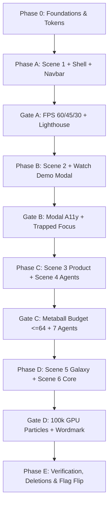

# ORBIT LANDING EXPERIENCE V4 — FILE-BY-FILE IMPLEMENTATION PLAN
**Document:** `docs/implementation_plan.md`  
**Status:** Architecture Proposal — Pending User Approval  
**Target:** Production-Grade Cinematic Founder Web Experience  
**Reference:** `.antigravity/rules.md` (Sections 16, 17, 18, 21, 24) & `docs/audit.md`  

---

## 1. Executive Overview & Codebase Conventions

This implementation plan specifies every single file touched, created, rewritten, deleted, or preserved for the Orbit V4 Cinematic Landing Experience.

### Workspace Path Mapping
The V4 Production Spec references `apps/web/`. In this repository, the Next.js 15 frontend application is located at:
```
apps/frontend/  (corresponds to apps/web/ in the spec)
```
All paths in this document reflect `apps/frontend/` for direct file execution accuracy.

### Rollback Strategy & Feature Flagging
1. **Feature Flag:** All new V4 landing architecture will be conditioned behind `NEXT_PUBLIC_LANDING_V4` (default `false` in production).
2. **V3 Baseline Preservation:** Before touching `apps/frontend/app/(marketing)/page.tsx`, the existing v3 marketing page will be backed up as `apps/frontend/app/(marketing)/page.v3.tsx`.
3. **Safe Deletion:** Old files marked `[DELETE]` will NOT be removed immediately; they will be decoupled, verified under the feature flag, and removed only in Phase 5 after passing visual and FPS gates.

---

## 2. Master File-by-File Inventory Matrix

Every file is classified with one of four tags:
* **`[CREATE]`**: New file to be authored to fulfill V4 specifications.
* **`[REWRITE]`**: Existing file to be substantially refactored or replaced.
* **`[DELETE]`**: Deprecated file to be removed behind feature flag after successful ship.
* **`[KEEP]`**: Existing file to remain untouched.

---

### Category A: Design System & Tokens

| File Path | Tag | Responsibilities & Exports | Inputs / Dependencies | Budget / Target | Verification Criteria |
| :--- | :---: | :--- | :--- | :--- | :--- |
| `apps/frontend/styles/tokens.css` | **`[CREATE]`** | CSS Custom Properties: `--bg-void`, `--bg-surface`, `--fg-primary`, `--fg-secondary`, `--fg-tertiary`, `--accent`, `--accent-glow`, `--signal`, fluid type clamps, 8px spacing, and cubic-bezier easing tokens. | None (pure CSS variables). | $\le 120$ LOC | CSS variables load on `:root` and inspect cleanly in DevTools. |
| `apps/frontend/lib/design/tokens.ts` | **`[CREATE]`** | Typed TypeScript constants mirroring `tokens.css`: `COLORS`, `TYPE_SCALE`, `SPACING`, `RADII`, `DURATIONS`, `EASINGS`, `SHADER_UNIFORMS`. | None (zero external deps). | $\le 100$ LOC | Unit test verifies `tokens.ts` values match `tokens.css` exactly. |
| `apps/frontend/tailwind.config.ts` | **`[REWRITE]`** | Extend Tailwind theme with V4 semantic color tokens, fluid font-size clamps, and custom transition timing functions (`ease-out-expo`, `ease-cine`). | `tailwindcss`, `tokens.ts` | $\le 90$ LOC | Classes like `bg-void`, `text-primary`, `font-display-xl` compile cleanly. |
| `apps/frontend/next.config.ts` | **`[REWRITE]`** | Add custom webpack/turbopack support for raw GLSL imports (`.glsl`, `.vert`, `.frag`) and optimize font caching headers. | `next` config API. | $\le 50$ LOC | Shader files can be imported as string templates without build errors. |

---

### Category B: Runtime Hooks & Profiling Infrastructure

| File Path | Tag | Responsibilities & Exports | Inputs / Dependencies | Budget / Target | Verification Criteria |
| :--- | :---: | :--- | :--- | :--- | :--- |
| `apps/frontend/hooks/useScrollProgress.ts` | **`[CREATE]`** | Tracks smoothed, normalized window scroll progress ($0.0 \to 1.0$), current scene index ($0..5$), per-scene progress ($0.0 \to 1.0$), and scroll velocity. Exposes mutable ref for 60fps canvas loop without React state re-renders. | `lenis`, `gsap` ScrollTrigger | $\le 140$ LOC | Window scroll smoothly updates progress ref; clamps correctly $0 \to 1$. |
| `apps/frontend/hooks/useDeviceTier.ts` | **`[CREATE]`** | Probes client GPU capability via 1024-instance render offscreen micro-benchmark; returns `'TIER_A'` (high), `'TIER_B'` (mid), or `'TIER_C'` (low/fallback). Caches result in `localStorage`. | WebGL2 context | $\le 110$ LOC | Returns Tier A on M1, Tier B on mobile, Tier C on software GL. Persists to storage. |
| `apps/frontend/hooks/usePrefersReducedMotion.ts` | **`[CREATE]`** | SSR-safe hook detecting `(prefers-reduced-motion: reduce)` media query; triggers static SVG mode automatically. | React `useState`, `useEffect` | $\le 45$ LOC | Emulates reduced-motion in Chrome DevTools; switches instantly to fallback. |
| `apps/frontend/hooks/useFpsMonitor.ts` | **`[CREATE]`** | Lightweight RAF frame-time tracker. Emits metrics to `/api/metrics` (sampled 1/30 frames). Triggers 3-stage auto-degradation: FPS < 45 for 3s drops particles 50%; FPS < 40 drops bloom; FPS < 30 falls back to Tier C static SVG. | React RAF loop | $\le 120$ LOC | Simulated frame drops systematically step down rendering quality. |

---

### Category C: Core Marketing Layout, Nav & Modals

| File Path | Tag | Responsibilities & Exports | Inputs / Dependencies | Budget / Target | Verification Criteria |
| :--- | :---: | :--- | :--- | :--- | :--- |
| `apps/frontend/app/(marketing)/layout.tsx` | **`[REWRITE]`** | Shell layout for marketing routes; imports `styles/tokens.css`, Geist fonts, skip-to-content accessibility link, and renders `Navbar`, `WatchDemoModal`, and `CommandPalette`. | Next.js layout, `tokens.css` | $\le 90$ LOC | Valid HTML5 landmarks, zero hydration mismatch. |
| `apps/frontend/app/(marketing)/page.tsx` | **`[REWRITE]`** | Primary landing route. Checks `NEXT_PUBLIC_LANDING_V4` flag; if false, renders preserved `page.v3.tsx`. If true, orchestrates `LandingCanvas`, `ScrollOrchestrator`, and 6 semantic `<section>` scene containers. | React, feature flag | $\le 160$ LOC | Switches between V3 and V4 cleanly via env var. |
| `apps/frontend/components/landing/Navbar.tsx` | **`[REWRITE]`** | Linear-style header: transparent at scroll 0, blurred border at scroll > 40px, auto-hide on scroll-down, reveal on scroll-up. Links: `[Orbit]`, `Features`, `How it works`, `Demo`, `Pricing`, `[Sign in]`, `[Register]`. Desktop ⌘K trigger. Mobile drawer. | Framer Motion, `useScrollProgress` | $\le 220$ LOC | Hides on downscroll, reveals on upscroll; ⌘K button triggers Command Palette. |
| `apps/frontend/components/landing/WatchDemoModal.tsx` | **`[CREATE]`** | 90vw × 90vh centered black scrim modal (`rgba(0,0,0,0.85)` + `backdrop-blur(24px)`). Plays `/public/demo.mp4` if present, else HLS stream, else 7-step Framer Motion animated product walkthrough with 7-segment progress bar. Keyboard focus trap, ESC close, scroll lock. | Framer Motion, HTML5 video | $\le 280$ LOC | Focus trapped on open; ESC closes; locks background body scroll. |
| `apps/frontend/components/landing/CommandPalette.tsx` | **`[CREATE]`** | Ubiquitous `⌘K` / `Ctrl+K` dialog. Fast keyboard search jumping to `#spark`, `#validate`, `#product`, `#agents`, `#galaxy`, `#core`, triggering Watch Demo modal, or navigating to auth routes. | `cmdk` or headless React | $\le 180$ LOC | Pressing ⌘K opens modal; arrow keys navigate items; Enter executes action. |
| `apps/frontend/components/landing/SceneShell.tsx` | **`[CREATE]`** | Semantic HTML `<section>` wrapper for each of the 6 scenes. Declares `id`, `min-h-[100vh]`/`150vh`/`200vh`, rule-of-thirds copy alignment, real `<h1>`/`<h2>`, micro-captions revealed on scroll-stop, and accessibility attributes. | React, semantic HTML | $\le 120$ LOC | Screen readers announce scene names; copy meets WCAG 2.2 AA $\ge 4.5:1$ contrast. |

---

### Category D: 3D Canvas, Orchestration & Scene Implementations

| File Path | Tag | Responsibilities & Exports | Inputs / Dependencies | Budget / Target | Verification Criteria |
| :--- | :---: | :--- | :--- | :--- | :--- |
| `apps/frontend/components/landing/LandingCanvas.tsx` | **`[CREATE]`** | Fixed full-screen R3F `<Canvas>` (`pointer-events-none`, `aria-hidden="true"`). Configures WebGL2 context, single `PerspectiveCamera (fov=42)`, ambient/key/rim lighting budget ($\le 4$ lights), selective bloom post-processing, and dynamic scene switching. | `@react-three/fiber`, `@react-three/postprocessing` | $\le 220$ LOC | Canvas renders at target DPR (clamped 1..2); WebGL context loss is handled safely. |
| `apps/frontend/components/landing/ScrollOrchestrator.tsx` | **`[CREATE]`** | Integrates Lenis smooth scroll and drives camera position lerping, lookAt vectors, and global uniform updates across Scenes 1 to 6. Cross-fades scene uniforms over 15% overlap. | `lenis`, `gsap`, Three.js | $\le 200$ LOC | Camera smoothly dollies and pans along narrative path without stutter. |
| `apps/frontend/components/landing/scenes/Scene1Spark.tsx` | **`[CREATE]`** | **Scene 1 (100vh):** Single emissive sphere ($r=0.4$), noise-displaced surface. Subtle 6s breathing cycle (scale $0.98 \leftrightarrow 1.02$). $\le 3$ draw calls. | Three.js, `spark.frag/vert` | $\le 160$ LOC | Maintains 60 FPS on M1 and 45 FPS on iPhone 13; draw calls $\le 3$. |
| `apps/frontend/components/landing/scenes/Scene2Validate.tsx` | **`[CREATE]`** | **Scene 2 (150vh):** Three concentric instanced torus rings. ~40 signal particles traveling along ring paths. Outward radial pulse every 3s. | Three.js `InstancedMesh`, `rings.frag/vert` | $\le 220$ LOC | Instanced rings rotate smoothly; signals travel splines without garbage collection spikes. |
| `apps/frontend/components/landing/scenes/Scene3Product.tsx` | **`[CREATE]`** | **Scene 3 (150vh):** 12 metaballs merging via raymarched SDF into a structured monolith; wireframe reveals structure at 60% scroll. | Three.js quad, `metaball.frag/vert` | $\le 260$ LOC | Raymarch steps capped at $\le 64$ (Tier A), $\le 32$ (Tier B), static mesh on Tier C. |
| `apps/frontend/components/landing/scenes/Scene4Agents.tsx` | **`[CREATE]`** | **Scene 4 (200vh):** Monolith fragments into exactly 7 constitutional agent nodes (*Market, Product, Architect, Sprint, Launch, Growth, Investor*) orbiting core with screen-space trails. Tiny monospace world-space sprites. | Three.js, `agent.frag/vert` | $\le 320$ LOC | Exactly 7 agent nodes; trails capped at $\le 7 \times 200$ points; no floating HTML cards. |
| `apps/frontend/components/landing/scenes/Scene5Galaxy.tsx` | **`[CREATE]`** | **Scene 5 (200vh):** GPU instanced particles ($\le 100\text{k}$ Tier A, $\le 30\text{k}$ Tier B, $\le 5\text{k}$ Tier C) clustered in 4 groups: *Customers, Revenue, Investors, Team*. Subtle distinct hues. | Three.js `InstancedBufferGeometry`, `particles.frag/vert` | $\le 350$ LOC | GPU memory $\le 64\text{ MB}$; particle buffers update on GPU without CPU bottleneck. |
| `apps/frontend/components/landing/scenes/Scene6Core.tsx` | **`[CREATE]`** | **Scene 6 (150vh):** Galaxy collapses inward (implosion); particles lerp to center; reveals 3D extruded monospace ORBIT wordmark + product UI preview. | Three.js, `implosion.frag/vert` | $\le 240$ LOC | Smooth implosion animation settles onto stationary crisp wordmark. |

---

### Category E: Static SVG Fallbacks (Accessibility & Tier C)

| File Path | Tag | Responsibilities & Exports | Inputs / Dependencies | Budget / Target | Verification Criteria |
| :--- | :---: | :--- | :--- | :--- | :--- |
| `apps/frontend/components/landing/fallbacks/SparkSVG.tsx` | **`[CREATE]`** | Static vector pulsing dot with subtle CSS radial gradient and gentle 6s breathe animation. | Pure SVG / CSS | $\le 70$ LOC | Renders cleanly when WebGL is disabled or `prefers-reduced-motion` is on. |
| `apps/frontend/components/landing/fallbacks/ValidateSVG.tsx` | **`[CREATE]`** | 3 concentric SVG rings with CSS keyframe traveling signal pulses. | Pure SVG / CSS | $\le 90$ LOC | Displays market validation graphic crisp at any viewport size. |
| `apps/frontend/components/landing/fallbacks/ProductSVG.tsx` | **`[CREATE]`** | Vector graphic illustrating 12 nodes merging into structured monolith. | Pure SVG / CSS | $\le 100$ LOC | Provides structural product visual on mobile/low-end devices. |
| `apps/frontend/components/landing/fallbacks/AgentsSVG.tsx` | **`[CREATE]`** | 7 orbital tracks with 7 labeled agent dots (*Market, Product, Architect, Sprint, Launch, Growth, Investor*). | Pure SVG / CSS | $\le 110$ LOC | Exactly 7 constitutional agents represented cleanly in 2D. |
| `apps/frontend/components/landing/fallbacks/GalaxySVG.tsx` | **`[CREATE]`** | Lightweight vector constellation (~5,000 dots or clustered gradient nodes) with gentle CSS float. | Pure SVG / CSS | $\le 120$ LOC | Zero GPU overhead on low-end mobile devices. |
| `apps/frontend/components/landing/fallbacks/CoreStatic.tsx` | **`[CREATE]`** | High-contrast static vector composition: ORBIT wordmark, core manifesto copy, and primary action CTAs. | Pure SVG / React | $\le 80$ LOC | Instant render with 0ms WebGL compilation time. |

---

### Category F: Modular GLSL Shader Programs

| File Path | Tag | Responsibilities & Exports | Inputs / Dependencies | Budget / Target | Verification Criteria |
| :--- | :---: | :--- | :--- | :--- | :--- |
| `apps/frontend/shaders/lib/noise.glsl.ts` | **`[CREATE]`** | Exported GLSL string functions: `hash(vec2)`, `noise2D(vec2)`, `noise3D(vec3)`, `fbm(vec3)` with 3 octaves. | Pure GLSL string | $\le 80$ LOC | Shader compiles cleanly in WebGL2; zero syntax errors. |
| `apps/frontend/shaders/lib/rotation.glsl.ts` | **`[CREATE]`** | Exported GLSL string functions: `rotate2D(float angle)`, `rotate3D(vec3 axis, float angle)`. | Pure GLSL string | $\le 50$ LOC | Provides unified matrix rotation math for rings and particles. |
| `apps/frontend/shaders/lib/fresnel.glsl.ts` | **`[CREATE]`** | Exported GLSL string functions: `fresnel(vec3 normal, vec3 eye, float power, float bias)`. | Pure GLSL string | $\le 45$ LOC | Emissive edge glow behaves identically across all materials. |
| `apps/frontend/shaders/spark.vert.ts` / `.frag.ts` | **`[CREATE]`** | Vertex: FBM displacement along normal. Fragment: Fresnel edge glow + core emissive violet (`#7C5CFF`). | `noise.glsl`, `fresnel.glsl` | $\le 75$ LOC each | Sphere displaces gently; mobile fallback disables high octaves. |
| `apps/frontend/shaders/rings.vert.ts` / `.frag.ts` | **`[CREATE]`** | Vertex: Instanced torus transformation. Fragment: Traveling signal pulse wave based on `u_time * speed`. | `rotation.glsl` | $\le 80$ LOC each | Signal pulses travel smoothly across instances. |
| `apps/frontend/shaders/metaball.vert.ts` / `.frag.ts` | **`[CREATE]`** | Vertex: Screen-quad pass. Fragment: Raymarched smooth minimum (`smin`) SDF of 12 spheres coalescing into box. | `noise.glsl` | $\le 130$ LOC each | Steps capped to 64; early ray termination on hit; tier downgrade safe. |
| `apps/frontend/shaders/agent.vert.ts` / `.frag.ts` | **`[CREATE]`** | Vertex: Orbital transformation + trail point billboarding. Fragment: Agent core glow + additive fading trail. | `fresnel.glsl` | $\le 90$ LOC each | Screen-space additive blend without depth buffer artifacts. |
| `apps/frontend/shaders/particles.vert.ts` / `.frag.ts` | **`[CREATE]`** | Vertex: GPU position calculation per cluster + point size attenuation. Fragment: Soft circular point + cluster hue. | Three.js uniforms | $\le 85$ LOC each | 100k particles render at 60 FPS on discrete GPU. |
| `apps/frontend/shaders/implosion.vert.ts` / `.frag.ts` | **`[CREATE]`** | Vertex: Particle inward collapse lerp + quaternion spin. Fragment: Dissolve into central emissive core. | `rotation.glsl` | $\le 90$ LOC each | Smooth inward collapse without particle flickering. |

---

### Category G: Deprecated Files to Delete (Kill List)

*All files in this table will be preserved under `page.v3.tsx` during construction, and deleted permanently once `NEXT_PUBLIC_LANDING_V4` is verified green.*

| File Path | Tag | Reason for Deletion | Replacement in V4 Architecture |
| :--- | :---: | :--- | :--- |
| `apps/frontend/components/landing/ai-entity.tsx` | **`[DELETE]`** | Unconnected legacy wireframe sphere demo; 2021 purple aesthetic. | `components/landing/scenes/Scene1Spark.tsx` |
| `apps/frontend/components/landing/universe.tsx` | **`[DELETE]`** | Generic force-directed node playground with `OrbitControls`. | `components/landing/scenes/Scene5Galaxy.tsx` |
| `apps/frontend/components/orbit/canvas/BlackHoleIntelligenceCore.tsx` | **`[DELETE]`** | Sci-fi "black hole" metaphor misrepresents Orbit; high fragment fill rate. | `components/landing/scenes/Scene6Core.tsx` |
| `apps/frontend/components/orbit/canvas/PlanetarySystem.tsx` | **`[DELETE]`** | "Planets and moon belts" disconnect from software; 17 `<Html>` badges ruin mobile FPS. | `components/landing/scenes/Scene2Validate.tsx` & `Scene3Product.tsx` |
| `apps/frontend/components/orbit/canvas/AgentConstellation.tsx` | **`[DELETE]`** | Displays 10 agents instead of constitutional 7; heavy un-batched DOM badges. | `components/landing/scenes/Scene4Agents.tsx` |
| `apps/frontend/components/orbit/canvas/VolumetricNebula.tsx` | **`[DELETE]`** | Decorative purple noise; wastes fragment fill rate. | Global subtle depth fog (`#0F0A1F`) |
| `apps/frontend/components/orbit/canvas/StarField.tsx` | **`[DELETE]`** | 3,600 un-batched star points; unneeded GPU background overhead. | High-performance particle clusters in Scene 5 |
| `apps/frontend/components/orbit/canvas/CosmicCameraController.tsx` | **`[DELETE]`** | Wild Catmull-Rom spline camera moves aggressively on scroll. | `ScrollOrchestrator.tsx` (smooth linear dolly) |
| `apps/frontend/components/orbit/canvas/OrbitalSceneContent.tsx` | **`[DELETE]`** | Legacy composite scene container holding astronomical meshes. | `LandingCanvas.tsx` |
| `apps/frontend/components/orbit/canvas/shaders/accretionDisk.glsl.ts` | **`[DELETE]`** | Procedural FBM fragment shader burning mobile GPU fill rate. | Modular GLSL library (`shaders/lib/*`) |
| `apps/frontend/components/orbit/canvas/shaders/eventHorizon.glsl.ts` | **`[DELETE]`** | Black hole event horizon shader; irrelevant metaphor. | `shaders/implosion.frag.ts` |
| `apps/frontend/components/orbit/canvas/shaders/starField.glsl.ts` | **`[DELETE]`** | Star shader with trigonometric twinkling. | Eliminated |
| `apps/frontend/components/orbit/hud/CelestialInspector.tsx` | **`[DELETE]`** | Sci-fi planet inspector drawer; irrelevant to software building. | Clean micro-captions revealed on scroll-stop |
| `apps/frontend/components/orbit/hud/AgentDebateStream.tsx` | **`[DELETE]`** | Chat simulation window covering 3D canvas. | Integrated into `WatchDemoModal.tsx` |
| `apps/frontend/components/orbit/hud/OrbitalTimeline.tsx` | **`[DELETE]`** | Floating timeline HUD component with high DOM count. | Top 1px progress line in `ScrollOrchestrator` |
| `apps/frontend/components/orbit/hud/CosmicSoundToggle.tsx` | **`[DELETE]`** | Sci-fi audio synthesis button; out of scope for founder OS. | Eliminated |
| `apps/frontend/components/orbit/sections/SectorEcosystem.tsx` | **`[DELETE]`** | Obsolete 5-sector copy structure. | Semantic `<section>` shells in Scenes 1–6 |
| `apps/frontend/components/orbit/sections/SectorCouncil.tsx` | **`[DELETE]`** | Obsolete 5-sector copy structure. | Semantic `<section>` shells in Scenes 1–6 |
| `apps/frontend/components/orbit/sections/SectorTrajectory.tsx` | **`[DELETE]`** | Obsolete 5-sector copy structure. | Semantic `<section>` shells in Scenes 1–6 |
| `apps/frontend/components/orbit/sections/SectorLaunch.tsx` | **`[DELETE]`** | Obsolete 5-sector copy structure. | Semantic `<section>` shells in Scenes 1–6 |
| `apps/frontend/components/orbit/demo/OrbitDemoCenter.tsx` | **`[DELETE]`** | Complex multi-tab mock console. | `components/landing/WatchDemoModal.tsx` |

---

### Category H: Preserved Codebase Files (Untouched)

| File Path | Tag | Reason for Keeping Untouched |
| :--- | :---: | :--- |
| `apps/frontend/app/api/**` | **`[KEEP]`** | Backend API proxies and endpoints; non-marketing domain. |
| `apps/frontend/components/ui/core.tsx` | **`[KEEP]`** | Base UI primitive. |
| `apps/frontend/components/ui/dialog.tsx` | **`[KEEP]`** | Accessible dialog primitive used by modals. |
| `apps/frontend/components/ui/orbit-logo.tsx` | **`[KEEP]`** | Official SVG vector logo component. |
| `apps/frontend/components/ui/webgl-error-boundary.tsx` | **`[KEEP]`** | Critical safety boundary catching WebGL crashes and displaying fallback. |
| `apps/frontend/lib/api/**` | **`[KEEP]`** | Type-safe REST client for auth, projects, and pipeline runs. |
| `apps/frontend/lib/stores/**` | **`[KEEP]`** | Zustand state stores. |
| `apps/frontend/lib/utils/cn.ts` | **`[KEEP]`** | Standard Tailwind class merging utility. |
| `apps/frontend/lib/analytics.ts` | **`[KEEP]`** | Production telemetry emitter used for scroll and demo tracking. |
| `apps/frontend/components/landing/auth-visual.tsx` | **`[KEEP]`** | Visual component on auth screens (`/login`, `/register`). |
| `apps/frontend/app/layout.tsx` | **`[KEEP]`** | Root application shell (HTML wrapper, theme providers). |

---

## 3. Phased Implementation Roadmap

In accordance with Section 24 (Steps 6 through 11), implementation is strictly broken into phased increments. **No scene will be built without shipping and verifying its predecessor.**



### Phase 0: Foundations, Tokens & Shader Helpers
* **Scope:**
  - Create `apps/frontend/styles/tokens.css` and `apps/frontend/lib/design/tokens.ts`.
  - Update `apps/frontend/tailwind.config.ts` with V4 tokens.
  - Create GLSL modular library: `shaders/lib/noise.glsl.ts`, `rotation.glsl.ts`, `fresnel.glsl.ts`.
  - Implement runtime hooks: `useScrollProgress.ts`, `useDeviceTier.ts`, `usePrefersReducedMotion.ts`, `useFpsMonitor.ts`.
* **Exit Criteria:**
  - `tokens.ts` matches `tokens.css`.
  - Shader helper strings import without typescript errors.
  - Device tier probe correctly identifies Tier A/B/C.

### Phase A: Scene 1 (The Spark), Navigation & Command Palette (Step 6)
* **Scope:**
  - Preserve `apps/frontend/app/(marketing)/page.tsx` as `page.v3.tsx`.
  - Create `apps/frontend/components/landing/SceneShell.tsx`.
  - Create `apps/frontend/shaders/spark.vert.ts` and `spark.frag.ts`.
  - Create `apps/frontend/components/landing/scenes/Scene1Spark.tsx` ($r=0.4$ sphere, $\le 3$ draw calls, 6s breath).
  - Create `apps/frontend/components/landing/fallbacks/SparkSVG.tsx`.
  - Create `apps/frontend/components/landing/Navbar.tsx` (scroll hide/reveal, ⌘K trigger, strict links).
  - Create `apps/frontend/components/landing/CommandPalette.tsx`.
  - Create initial `apps/frontend/components/landing/LandingCanvas.tsx` and `ScrollOrchestrator.tsx`.
  - Wire Scene 1 into `page.tsx` behind `NEXT_PUBLIC_LANDING_V4`.
* **Exit Criteria:**
  - Scene 1 runs at solid 60 FPS on desktop, $\ge 45$ FPS on mobile.
  - Draw calls $\le 3$.
  - Navbar transitions from transparent to blur at 40px scroll.
  - ⌘K opens Command Palette.

### Phase B: Scene 2 (Validation Orbit) & Watch Demo Modal (Step 8)
* **Scope:**
  - Create `apps/frontend/shaders/rings.vert.ts` and `rings.frag.ts`.
  - Create `apps/frontend/components/landing/scenes/Scene2Validate.tsx` (3 instanced rings, 40 traveling signals).
  - Create `apps/frontend/components/landing/fallbacks/ValidateSVG.tsx`.
  - Create `apps/frontend/components/landing/WatchDemoModal.tsx` (90vw × 90vh, black scrim, 7-step walkthrough fallback, focus trap, ESC close).
  - Wire Watch Demo triggers from Navbar and Hero CTA.
* **Exit Criteria:**
  - Ring instancing produces $\le 4$ draw calls.
  - Modal traps keyboard focus cleanly; ESC key dismisses modal and restores focus.
  - Scroll locks while modal is open.

### Phase C: Scene 3 (Product Formation) & Scene 4 (Agent Awakening)
* **Scope:**
  - Create `apps/frontend/shaders/metaball.vert.ts` and `metaball.frag.ts`.
  - Create `apps/frontend/components/landing/scenes/Scene3Product.tsx` (SDF raymarched 12 metaballs $\to$ monolith, steps $\le 64$).
  - Create `apps/frontend/components/landing/fallbacks/ProductSVG.tsx`.
  - Create `apps/frontend/shaders/agent.vert.ts` and `agent.frag.ts`.
  - Create `apps/frontend/components/landing/scenes/Scene4Agents.tsx` (exactly 7 constitutional agents: *Market, Product, Architect, Sprint, Launch, Growth, Investor*, orbital paths, screen-space additive trails $\le 7 \times 200$).
  - Create `apps/frontend/components/landing/fallbacks/AgentsSVG.tsx`.
* **Exit Criteria:**
  - Metaball raymarching disabled on Tier C (falls back to static mesh/SVG).
  - Agent trails generate zero memory leaks (buffers recycled).
  - Exactly 7 constitutional agents rendered, matching Orbit Constitution v2.

### Phase D: Scene 5 (Startup Galaxy) & Scene 6 (Orbit Core)
* **Scope:**
  - Create `apps/frontend/shaders/particles.vert.ts` and `particles.frag.ts`.
  - Create `apps/frontend/components/landing/scenes/Scene5Galaxy.tsx` (GPU instanced particles $\le 100\text{k}$, 4 clusters: *Customers, Revenue, Investors, Team*).
  - Create `apps/frontend/components/landing/fallbacks/GalaxySVG.tsx`.
  - Create `apps/frontend/shaders/implosion.vert.ts` and `implosion.frag.ts`.
  - Create `apps/frontend/components/landing/scenes/Scene6Core.tsx` (inward collapse, 3D extruded monospace ORBIT wordmark, real UI preview reveal).
  - Create `apps/frontend/components/landing/fallbacks/CoreStatic.tsx`.
* **Exit Criteria:**
  - Particle system consumes $\le 64\text{ MB}$ GPU memory.
  - Implosion completes cleanly and locks on wordmark.
  - No fake stats, no testimonials, no logos.

### Phase E: Verification, Deletions & Feature Flag Flip
* **Scope:**
  - Execute full Lighthouse audit: verify Performance $\ge 95$ (mobile), $\ge 98$ (desktop), A11y 100, Best Practices 100, SEO 100.
  - Verify WCAG 2.2 AA compliance: axe-core audit (0 violations), reduced-motion mode, keyboard navigation.
  - Delete deprecated legacy files from Kill List.
  - Produce `docs/performance_report.md` and `docs/before_after.md`.
  - Flip default `NEXT_PUBLIC_LANDING_V4` flag to `true`.
* **Exit Criteria:**
  - All 15 checklist items of Definition of Done (Section 23) checked green.

---

## 4. Verification Checklists & Quality Contracts

### Performance Contract (Section 13)
* [ ] Initial JS bundle $< 180\text{ KB}$ gzipped.
* [ ] Three.js chunk lazy-loaded $< 220\text{ KB}$ gzipped.
* [ ] FPS $\ge 60$ (M1), $\ge 45$ (iPhone 13), $\ge 30$ (mid-tier Android).
* [ ] Zero frame drops $> 33\text{ms}$ during smooth scroll.
* [ ] Dynamic lights $\le 4$ active simultaneously.

### Accessibility Contract (Section 14)
* [ ] All text passes $\ge 4.5:1$ contrast ratio over 3D backgrounds.
* [ ] WebGL Canvas has `aria-hidden="true"`.
* [ ] All copy lives in semantic DOM elements (`<h1>`, `<h2>`, `<p>`).
* [ ] `prefers-reduced-motion` renders static vector fallbacks immediately.
* [ ] Screen reader live region announces scene transitions.
* [ ] Keyboard focus indicator (2px accent) visible on all interactive elements.

### Constitution v2 Integrity Contract
* [ ] Exactly 7 agents: *Market, Product, Architect, Sprint, Launch, Growth, Investor*.
* [ ] Zero sci-fi space tropes (no black holes, no moons, no planet belts).
* [ ] Zero fake statistics or fabricated social proof.
* [ ] Typography strictly uses Vercel Geist high-contrast scale and monospace uppercase eyebrows.

---

## 5. Next Step
Per Section 24 of the V4 Production Spec:
* Deliverables 1 (`docs/redesign_strategy.md`) and 2 (`docs/implementation_plan.md`) are now complete.
* **Execution stops here.**
* Awaiting explicit user approval before writing any code or initiating Phase A.
